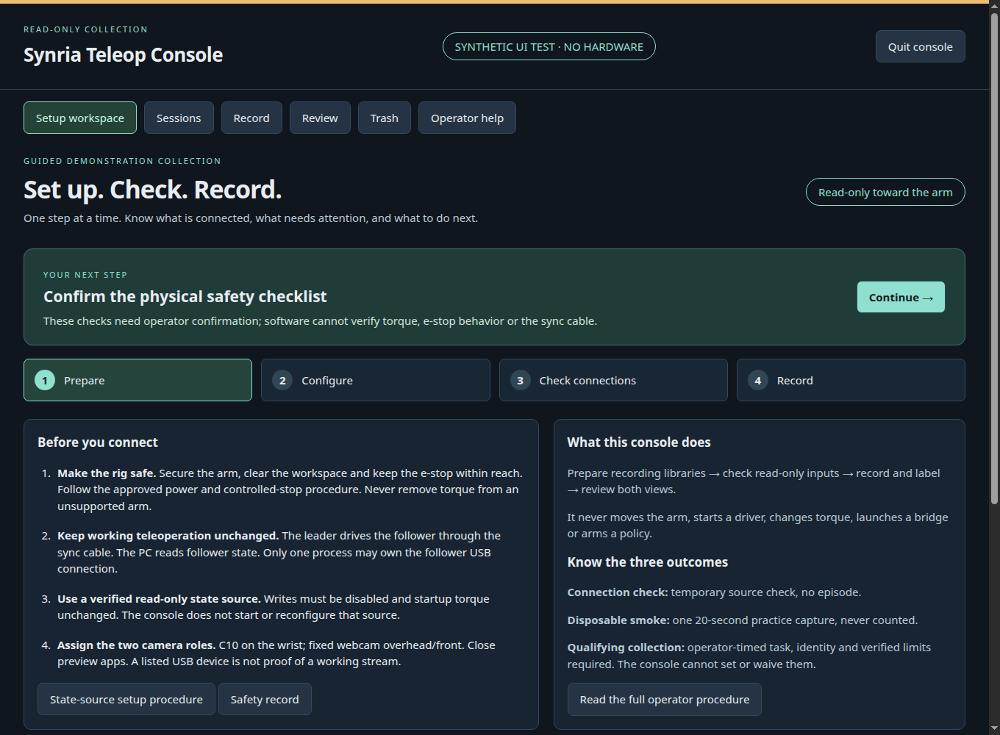
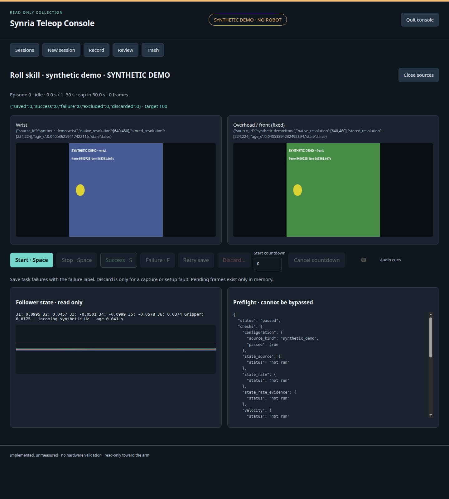

# Synria Teleop Console

**Implemented, unmeasured.** A local recording and review surface for the
Synria/Alicia-D leader-follower operator. It observes the existing recorder;
it does not move the arm or start teleoperation. D1–D5 remain planned.

## Launch

Use the existing Python 3.12 recording environment with the `robot-learning`
extra and ffmpeg. Demo also needs that extra: it writes real upstream datasets,
not a substitute format. Use an editable repository install so the canonical
task registry and limits remain beside the installed sources. From the repository root:

```bash
source "$RECORDING_VENV/bin/activate"
python -m pip install -e '.[robot-learning,vision]'
synria-teleop-console --demo --workspace "$HOME/synria-console-demo"
```

The browser opens automatically. For a future authorized physical session,
complete [the D1 safety and wiring preflight](D1_OPERATOR_RUNBOOK.md#1-safety-wiring-and-recording-environment),
retain its read-only state-source configuration, then launch:

```bash
scripts/linux_rtx/synria_teleop_console.sh --workspace "$HOME/synria-console"
```

The [RTX launcher](../../scripts/linux_rtx/synria_teleop_console.sh) activates
`RECORDING_VENV` (default `/srv/venvs/synria-d1-py312`, then
`$HOME/venvs/synria-d1-py312` if the former is absent). Physical mode sources
`RECORDING_ROS_SETUP` (default `/opt/ros/jazzy/setup.bash`) to expose library paths;
demo mode skips that setup. It never starts a ROS node or any robot process.
A missing setup file produces a Not ready warning but still opens the interface
so its dependency errors are visible. Copy the [desktop entry](../../scripts/linux_rtx/synria-teleop-console.desktop)
to `~/.local/share/applications/`, adjusting its checkout, workspace and
environment paths for this host; preserve the authorized ROS domain and middleware
settings. Neither launch configures a driver. Direct entry-point launches still
require an already prepared recording/ROS environment.

### Simulation mode

`synria-teleop-console --simulation` (or `python -m synria_lerobot.console.app
--simulation`) records from the Isaac Sim teleop scene instead of the arm: the
state source is `/isaac_joint_states` and the two recorded cameras are the
sim's wrist camera and its overhead camera (`/isaac/wrist_camera/image_raw`
and `/isaac/overhead_camera/image_raw`), the same two views as the physical
rig, all published by the scene's record mode at twice the dataset rate, as
the real cameras and arm outrun it, so the newest sim sample is never a whole
dataset period older than the leader reading taken with it. The sim's side-on
front camera (`/isaac/front_camera/image_raw`) appears on the record page as a
third panel, Front view, marked preview only: the console subscribes to it
while a session is open so the operator can see the arm and the objects, and
it is never recorded or counted by any check.
The page shows an Isaac record mode panel with one fixed button. The launcher
path comes from `SYNRIA_ISAAC_LAUNCHER` or `isaac_launcher.json` in the
workspace, never from the page. The panel polls the launch it started: while
the scene is loading it names the step it waits for and the time waited, and
it does not wait out the start timeout when the launch has already died. The
Isaac process id and Isaac log path the launcher prints are kept in the launch
record; when that process is gone with no record-mode instance in its place,
or the launcher exits without printing one, the launch is marked failed at
once, the last error lines of the Isaac log are shown under the panel, and the
button becomes Relaunch Isaac record mode. The start timeout remains the last
resort. The requested-rate check accepts a callback count that is one short
of the requested periods over the measurement window, the resolution of a
count, and never a source more than five percent slow; the same rule applies
when a session summary is written.

## Use

The page has one navigation model. Outside a flow the global nav offers three
places only: **Home**, **Sessions** and **Help**. Home asks "What would you like
to do?" and shows three cards that are things to do, each a single control:
New session (Start a new session), Continue recording with the task, takes
saved and last use when an unfinished session exists (otherwise Practice run),
and Review recordings (disabled with "No takes recorded yet" until a take
exists). Under the cards a dismissible first-run strip names the three steps
until the first session exists, and a System status strip shows Arm feed,
Wrist camera, Overhead camera and Storage in neutral words ("Not checked yet"
before any check, "Last check: 2 minutes ago" after), with Software only when
something is missing and a Check now button that runs the same read-only
setup check (in physical mode it opens Check setup, where the bench checks
are). A notice appears when the tab has no launch key. Shut down console lives
on the Help page with a confirmation that says what it does and that saved
takes are safe. On the very first visit, before any session exists, a one-time intro names
the three steps and the bench points and continues to Home. Sessions lists
each session in words (task, Open now / Paused / Finished / Not started, takes
saved against the target, labels, size, last used) with Open session or
Continue recording, Review takes, Rename and Delete; Reindex and Trash sit
under **More**. Help holds the bench points, every procedure, the repository
references, the keyboard shortcuts, the console status label, Shut down and
the glossary. Inside a flow (new session, recording,
review, summary) the global nav is replaced by a breadcrumb and one Exit
control, or Pause session and Finish session while a session is open.
Every place has a hash address (`#/home`, `#/sessions`, `#/help`, `#/new/task`,
`#/new/check`, `#/session/<id>/record`, `#/session/<id>/review/<take>`,
`#/session/<id>/summary`) so browser Back, Forward and refresh keep the place;
on load the page opens the recording screen if a session is open, otherwise
Home. Each screen change moves focus to the screen title and announces it
through a live region. Navigating never opens a source, creates a session or
issues a recorder command. The footer carries one reassurance: this console
only records and never moves the arm.
New session is a linear wizard of two steps: **Choose task** and **Check setup**.
A fixed footer on every step holds Back at the left and one primary button at
the right; the primary stays disabled until the step is complete and the footer
lists what is left, in order ("2 things left: choose the gripper size, tick the
bench checks"). The stepper is an indicator: a completed step shows a tick and
can be revisited, the later step cannot be clicked, and its address is clamped
back while the first step is incomplete. Back never loses input: the draft (task, session name, target, scene note and
the setup fields, never the safety confirmations) is kept in per-tab storage and
a refresh restores the same step with the same inputs.
Choose task shows one card per registry task in sentence case with a chip
("Practice only until timed" or the take length); choosing one shows the scene
before each take as bullets, the success rule, one plain status, and the session
name (suggested in words: task, day, count) with the target number of takes
(10 takes (quick trial), 50 takes, 100 takes, Other).
Check setup has three blocks: Your setup (one summary line naming gripper, arm
feed, cameras and rate; any missing required value as an inline field with
focus on the first; the gripper size as two radio buttons; the starting power
state as a two-way choice; the follower serial as the remembered dropdown; the
full form behind Change setup), Cameras and arm feed (four tiles: Arm feed with
its readings per second, Wrist camera and Overhead camera with a thumbnail of
the sample the check read, and Storage; each Checking, OK, Problem or Not
checked yet; a Problem tile says what is wrong, the likely cause and how to fix
it; one Check now / Check again button; the software environment, meter and the
full check list sit under a collapsed Technical details), and in physical mode
I have checked the bench with five plain-words checks. The read-only setup
check starts by itself when the step is entered with the required values and
bench checks in place, and again after a setting changes; running it is never
left to the operator. The primary on this step says what will happen:
**Start session** when takes will count toward the dataset, or **Start
practice run** when the task is not timed yet or the joint limits are not
verified, with one line saying why; the demo says its takes never count. Start
session reruns a check older than a minute in place (tiles show Checking, then
the result), creates the session, opens its cameras and arm feed and lands on
the recording screen. A failing check stays on the step with its fix; the
operator is never sent back. **Do a practice run instead** sits beside Start
session in physical mode. On the first step the footer's left button is Cancel
and goes Home; the target defaults to 10 takes, or the last session's target. The
scene text sent to the recorder is the task's scene requirements plus an
optional note on what is different today. Nothing navigates by itself except
after the primary button.
Help is a page of procedures, repository references and a glossary; the same
procedures open in place from any error. It works without external network access. The state-source procedure distinguishes
an unverified standalone candidate from the still-unrecorded site-specific
read-only ros2_control startup procedure. Neither is executed by the page.



Four connection cards separate follower, action source, wrist and fixed-front
status from software availability and qualifying evidence. A created subscription
is not proof of incoming data. Stale or changed settings invalidate connection
results. Errors offer short recovery steps for state timeout/domain mismatch,
camera ownership, rate, freshness, competing publishers, disk space, contract
mismatch, blocked recovery and failed saves. Technical details remain expandable.
Background polling never dismisses an error or repeats a failed mutation.
Retry save preserves pending frames; successful explicit retry clears its error.
Keyboard capture controls are disabled inside dialogs, focused controls and
browser shortcut combinations. No procedure can bypass a recorder guard.

Readiness blockers include direct next steps: missing serial/power metadata
jumps to the empty field and explains where to find each value; task timing opens
the registry status; limits opens the read-only config. Source alignment is
neutral **Not checked** until every required fresh sample exists. With all
samples present, it reports the measured skew against the existing threshold.
The Alicia-D Isaac ghost-arm soft cap and simulation self-collision geometry are
not treated as physical-arm verification or as the recorder's collision gate.
The current scalar joint/gripper candidates in config/synria_limits.yaml stay
unverified until an operator verifies the physical arm and gripper.



Home lists named sessions and saved success/failure, excluded and target counts.
Create selects the registry task, explicit gripper/source kind, cameras, rate,
image size and operator metadata. Real task windows remain unset: qualifying
collection is refused until prospective operator timing is recorded in
[DECISIONS.md](DECISIONS.md) and the registry is configured outside the console.
Only disposable smoke is available before then. Its button runs the shared
preflight and lands on the record page in Ready; the operator presses Start
recording, the countdown runs, and one temporary capture of the practice run
length (30 s unless the operator sets it) follows. This flow is fake-tested,
not hardware-verified. Review remains available until
closing its context, when temporary data is disposed. It never qualifies.
When the smoke context closes, the console writes
`smoke-reports/smoke_<source kind>_<UTC timestamp>.json` in the workspace with
the settings (serials and USB ids left out), the measured state rate and, per
episode, frame count, duration, achieved sample rate, expected and dropped
frames, and each camera's distinct frames and delivered rate. Copy a physical
one into `reports/smoke/` to cite it.

The new-session form offers documented Synria presets: explicit 15/30 FPS
choices, 224-pixel stored dimensions, one-frame lookahead, a 10-second first-state
wait and 10/50/100-episode targets. Each has a custom-value option; existing
validation remains authoritative. Follower-state actions remain the default
for hardware-sync wiring; USB leader actions remain optional. Gripper and state
source have no assumed selection. Choose actual camera IDs, identity and power
state yourself. Presets are candidates or software defaults, not hardware
measurements, verified limits or qualifying counts. The native final still and
operator-owned task windows are unchanged. **Implemented, unmeasured.**

Task-window registration is deliberately not an editable console control. On
Choose task, open **Task timing controls are not in this console** to see
**Task timing registration · read only**. That panel shows each registered window and the
exact sequence: time the real task under the approved procedure, record the
observation and chosen bounds in `DECISIONS.md`, then update
`config/synria_tasks.json` through a reviewed repository change. The console
does not accept timing values or let an operator bypass review; until the
registry has a valid window, qualifying session creation remains blocked.

Setup fills the host/account and available storage from this machine, restores
recent operator-entered gripper/source/camera/scene fields for review, and
suggests the runbook's 15 FPS starting candidate plus the existing image,
lookahead and startup defaults. Use recommended recording values reapplies
these candidates; it does not change a saved session or the CLI's required FPS.
New edits made while setup loads are preserved. Safety confirmations are never
restored or automatically checked; current power and manufacturer serial are
not inferred from past sessions.

USB connection identity lists stable `/dev/serial/by-id/` names without opening
ports. A sole available entry is offered as an **unverified candidate**, not a
proven follower association. Unknown/unverified remains an explicit selection
when none is chosen; multiple connections are not assigned automatically.
The optional hint is stored separately in session settings and its mirror,
never copied into the manufacturer serial or used to open a port. Missing
required fields are named individually. Unknown manufacturer identity remains
a recording blocker; selecting a USB ID does not remove that requirement.
The manufacturer-serial dropdown offers values saved in prior physical
sessions and in the private workspace file `follower_serial_options.json`; a
manual option is available for first use. These are explicit choices, not a
live device probe. The ROS joint-state topic does not publish the manufacturer
serial. Enter the value printed on the follower label once; it is then
available in future session dropdowns.
This file stays outside the repository and demo mode never reads these values.
Missing manufacturer serial or starting-power text does not block the no-episode
connection diagnostic. Its separate **recording metadata** check lists these
missing facts, leaves them unknown and prevents green readiness. Creating a
session or recording a disposable smoke episode still requires both fields.
The session form also shows registration status for every task and a staged
training curriculum. Cup pickup/placement, die pickup/placement, and a
contained low-energy table release are planning targets, not selectable tasks
until reviewed into the registry with their own protocol and timed window. The
three fixed-scene roll skills remain the only registered skill set; board-token
manipulation stays deferred until the roll skill is validated. Each future
dataset is governed by its task-specific success rule, scene and episode window.
The operator must still confirm actual power and all physical safety checks
before any diagnostic source opens. Unattempted checks say **NOT CHECKED**, not
that the device failed.

**Pre-recording readiness** on New session offers a read-only check button and
a text-labeled red/amber/green meter. First select the two cameras in the
dedicated Camera mapping panel; Refresh camera IDs lists names without opening
devices. Two video interfaces advertising the same USB identity are refused as
a two-camera mapping. No camera roles are guessed.

The separate software panel shows **Launching** while checking availability,
then **Ready** or **Not ready**, with one row for each library/encoder and a short
missing-dependency message. It checks automatically on page load and before
connection preflight; Recheck software does not start sources or services.
Library discovery is not a compatibility or hardware test. Each connection path
(follower state, action source, wrist camera and overhead camera) also has its own
status and failure reason. **Launching** on a source path means opening/checking
read-only inputs, never launching a driver. Unattempted paths remain **Not checked**;
technical details are collapsed beneath the short message. No software status
overrides the recording metadata, timing, limits or physical safety checks.

Before physical checks, explicitly confirm the runbook safety preflight,
secured arm, emergency stop, unchanged-torque read-only source, leader sync
connection and camera identities. The button temporarily opens subscriptions
and cameras through the existing recorder builder using disposable purpose,
then closes them and removes its empty temporary dataset. It does not start an
episode, save a demonstration, start a driver or move either arm. It checks
dependency availability, state callback rate, source freshness/header stamps,
velocity requirements, command-topic publisher guards, frame size/brightness,
distinct samples, timestamp alignment, configured limits, disk space and task
configuration. Each result and operator confirmation is audited in the catalog.

The meter says **Not checked**, **Checking connections**, **Connection checks
incomplete**, **Connected · setup required**, or **Ready for session preflight**.
Unverified limits or unset task timing prevent green physical readiness even
when connections work. Results expire after 60 seconds; edited form settings
or withdrawn confirmations invalidate green display. Demo results are always
labeled synthetic. The button refuses to open a second pair of sources while
a session owns them. Green is a connection snapshot, not motion authorization:
the actual session contract, dataset lock/recovery and start guards still run
again. A standalone leader without USB, physical cable integrity, torque,
e-stop function and camera framing cannot be certified by software. Frozen
video and full episode quality still require their existing recording gates.
No live physical check was run during development. **Implemented, unmeasured.**

Recording is a mode. The breadcrumb reads Home and the session name; the
heading reads "Take N of M" (takes count from 1 wherever a person reads them;
stored indices stay zero-based). While a session is open the nav holds **Pause
session**, **Restart session** and **Finish session** instead of Exit, all
hidden during a countdown or a take. Restart closes the sources and opens the
same session again in Ready (for a practice run, it starts another practice
run with the same setup values); like Pause, it refuses while a stopped take
is unsaved. Pause releases the cameras and arm feed, keeps every saved take and
shows a neutral confirmation on Home that clears on the next navigation; the
session reads Paused in the list. Finish marks the session Finished (a status,
not a lock: Reopen to add takes reverses it), asks once inline when below
target, and shows the session summary (task, takes saved against the target,
success, failure, excluded, task source, whether takes count toward the
dataset, last used in words; Record another session of this task as the one
primary, Review takes beside it, file paths under Technical details). Both
refuse while a stopped take is unsaved. Counters always show session totals. The banner keeps a fixed
height and states one phase in words: Ready ("Set the scene, then press Start
recording"), Get ready with the countdown, Recording with the seconds left and
a red pulsing border, Did it work? with a short note that a real task failure
is saved as failure and only a bad capture is thrown away, Saving, Save failed
with the frames kept, Nothing captured, Practice run finished, Session paused,
or Recording blocked. The action area below also keeps a fixed height and shows
only the actions that apply: one large Start recording (Space); one large Stop
(Space); Yes, save as success (S) and No, save as failure (F) in different
colours with a small Throw away, bad capture; Retry save only after a failed
save; Cancel countdown only during a countdown; Run another practice run and
Finish practice run when a practice run has ended (Run another closes the
finished run and starts a new one with the same setup values). After a
save the banner reads "Take N saved as success. Quality checks passed" (or
"Quality check failed: joint limits", or "Quality checks not run yet" until the
result is known) for two seconds, then returns to Ready with that line kept
underneath until the next recording starts. Quality checks also run on demo data and say so. The counters
read in words with the target or practice note; Review last take opens the
frame-exact review as an overlay and returns to the same recording state. A
small Options row holds the countdown before recording (default 3 s) and sound
cues (on by default). Camera views are captioned Wrist camera and Overhead
camera with a Live badge, show a warning on the tile when frames go stale, and
take a red border while recording; age and native size sit inside Source
details. Between takes, Reset the scene lists the task's scene bullets beside
the cameras. Follower state, preflight and the last saved take's record sit
under Technical details. Space starts and stops; S and F label a stopped take,
which is what saves it. No recorder transition, guard or shortcut changed.
Throw away needs confirmation and a reason. Tab closure does not stop capture;
the server enforces the cap. Quit refuses pending frames. Process signals close
sources and audit any lost pending frames.

Review locks both cameras to the same stored row, with frame stepping, scrub,
speed, state/action traces, timestamps/skew, provenance and native final still.
Server-side decoding and a bounded JPEG cache avoid browser video-codec needs.
Playback only displays data. Close the capture run before curation or reindex.

The synthetic demo's cameras tick at 30 frames per second and its arm feed at
50 readings per second, like the real devices, independent of the recording
rate; ticking at the 15 Hz recording rate made back-to-back reads straddle a
66.7 ms boundary often enough that the unchanged 0.050 s alignment gate failed
at random. A test runs the setup check twice from several clock phases and
requires the same verdict.

## Teach a new task from a sentence

Choose task ends with a **Teach something new** card. On that screen the
operator types what to teach the arm ("train to roll a dice") and presses
**Break it down**; three example chips fill the box with sentences the built-in
planner handles. The planner answers with a goal, a note on why the boundaries
are where they are, a chain strip ("1 Die into cup, then 2 Roll and set the cup
down, then 3 Die back to start (reset)", with optional recovery steps named
separately) and one compact read-only card per step: short name, the
instruction sentence that becomes the take label, Starts with, Ends with, a kind
chip and suggested takes. Only chain steps are numbered; optional cards say
Optional. A novice can accept the proposal without touching a field. Edit on a
card opens the full form (states, success rule, scene lines, objects grasped,
camera confirmation, kind, optional) with Move up, Move down, Split, Merge with
next and Delete inside it. The chain check's warnings appear in plain words on
the card they concern and never block saving; only an empty name or instruction
does. The screen has the wizard's fixed footer: Cancel on the left, a reason in
the middle, Save tasks on the right, shown only once a breakdown exists. Break
it down is the primary until then and reads Break it down again afterwards; in
the guided fallback ("The planner could not work out the object and where it
goes from that sentence", followed by what the built-in planner understands) the
only primary is Break it down with these answers, with an Add steps by hand link
that opens one blank card in Edit. After Save tasks the page goes forward to
Choose task with the new goal group shown, its first step preselected and one
line saying how many tasks were saved. The line under the goal says whether the
built-in planner or the external task planner command made the suggestion.

The planner is a pure Python package with one validated schema and two backends
behind one interface. The built-in planner works offline from a primitive
vocabulary (pick, place, drop into, pour out, shake, push, open, close, return
to ready) and a small recipe set, including the seed breakdown for rolling a
die (die into cup; roll and set the cup down; die back to start; optional
recovery: stand the cup up); when it cannot parse a sentence it asks which
object, which container and which destination. The external command is
configured only through the `SYNRIA_TASK_PLANNER_COMMAND` environment variable
read at launch, never from the browser: the console passes the goal sentence,
the rules and the schema on stdin as JSON with no shell, waits a bounded time,
validates the JSON reply and falls back to the built-in planner on any failure,
saying so. The eight breakdown rules are shown under "Rules the planner
follows" and passed to the command verbatim.

Saved tasks live in a task library in the console workspace database, outside
the repository, as immutable versions: a version that a session has bound to is
frozen and an edit creates the next version; an edit before any take replaces
the version. The task dropdown and cards group library tasks under their goal
("Roll a die: 1 Die into cup") after the built-in tasks, with a chip "Library
task, not in the published registry". A session on a library task records
against a one-task snapshot file written once per version under
`library-snapshots/`, and its dataset contract keeps the exact task snapshot
and hash as today plus the task source, goal id, goal title, version and chain
position, so takes can be stitched into the full task later. Every quality gate
runs on these takes and the session summary names the source, but library
takes never count toward the published milestones; the published registry in
`config/synria_tasks.json` stays the source for evidence claims. A goal can be
exported as a registry shaped JSON fragment for a reviewed commit. An untimed
library task, like an untimed registry task, allows practice runs only; its
take window is stored with the task version once the operator confirms it.

**Time it** sits on a library task's panel on Choose task (not in demo mode). It
opens a small dialog, subscribes read-only to the arm feed through the
recorder's own joint-state subscriber, learns the rest pose for three seconds,
then times each move from first motion to rest for three to five moves,
noting the peak joint and whether the gripper closed and reopened. It
proposes a take window from the runs (shortest take about 0.8 of the fastest
move, longest about 1.3 of the slowest) which the operator can edit and must
confirm; the confirmed window and the runs are stored with the task version,
and a frozen version gets a new version. It refuses while a session is open
or a setup check is running, and it never publishes anything.

## Storage and curation

The workspace must be outside git. It contains `console.sqlite3`, five rotating
consistent backups in `backups/`, and `sessions/<slug>/session.json` beside
`dataset/` and `dataset.exclusions.jsonl`. Synthetic sessions instead occupy
`sessions-demo/` and show a demo banner. Trash is `trash/<slug>-<utc>/`.
No console file is placed inside the recorder-owned dataset root. The dataset
and sidecars are authoritative; SQLite is a rebuildable catalog and append-only
audit log. Saves commit the dataset before catalog insertion. Reindex repairs
missing catalog facts from session mirrors and sidecars and records differences:

```bash
synria-teleop-console --workspace "$HOME/synria-console" --reindex
```

Discard abandons unsaved memory. Exclude keeps saved bytes and labels, appending
a reason/operator/time to the sibling log; Restore appends the inverse decision.
Quality-valid demonstrations that fail the task retain their failure label.
Summaries separate exclusions and reject stale curation hashes. Training reads
the same log but **refuses active exclusions** to preserve its frozen hash-bound
partition, with a specific refusal for excluded held-out probes; supported
subset training remains follow-up. Accepted runs record the log hash and IDs.

Delete needs an idle, unlocked session, exact typed name and reason; it moves
the directory to trash. Restore moves it back. Purge permanently removes trash
and retains an audited tombstone with counts, size, time and reason. Interrupted
purges retain their intent and can be retried; a removed directory is reconciled
before declaring completion. A cited session warns that committed evidence
needs a correction; the console never edits that evidence or saved labels.
Automatic evidence lookup uses the session slug. Before deleting, the operator
must also check differently named or manually created artifacts and record any
required correction; those links cannot be discovered from the slug alone.

## Safety and limits

The console adds no publisher, service/action client, serial access or motion
control. Existing contract, velocity, measured-rate, command-publisher, recovery,
freshness and quality checks remain in force. Preview reuses source samples;
it never opens a second camera. A free-space floor blocks Start. One instance
owns each workspace. Loopback is the default; mutations require POST plus the
per-launch token and valid Host/Origin. No external assets or uploads are used.
Non-loopback serving needs `--allow-remote` and is not recommended for recordings.
Demo contracts are refused by D1 summaries, training, serving and D2.

No hardware, camera device, serial port, ROS runtime, driver, bridge, launch
file or teleoperation was run. Physical discovery, timing, visibility and safe
site integration still need operator validation and a hardware safety review.
Object success is the operator's label plus a camera still; no independent sensor confirms it.

## Related operator surfaces — as documented on 2026-10-10

The linked pages were rechecked on that date; silence is recorded as “not
documented,” not absence of a capability. This is a scope comparison, not a ranking.

| Surface | Documented collection/review | Session evidence on the linked pages |
|---|---|---|
| [LeRobot recording](https://huggingface.co/docs/lerobot/main/en/il_robots) and [dataset tools](https://huggingface.co/docs/lerobot/en/using_dataset_tools) | Terminal right/n ends an episode, left/r repeats, Escape/q stops; optional Rerun display through `--display_data=true`; `repo_id`, `--resume=true`, hosted dataset visualizer after upload; deletion with `lerobot-edit-dataset`. | Per-episode success/failure labels, named sessions and a database are not documented there. |
| [LeLab](https://huggingface.co/docs/lerobot/en/lelab) | LeRobot graphical interface; currently documented for SO-ARM101 only; task text, episode count/durations and spacebar episode advance. | Synria read-only graph guards and this session-audit contract are not documented there. |
| [phosphobot](https://docs.phospho.ai/basic-usage/dataset-recording) | Dashboard dataset browser; recording through the Meta Quest app or recording API; LeRobot v2 output. | This Synria contract and append-only exclusion protocol are not documented there. |
| This console | **Implemented, unmeasured:** read-only collection with visible graph guards; named exact-contract resume; operator labels and per-save gates; offline frame-exact two-camera/state/action review. | **Implemented, unmeasured:** audited curation and downstream exclusion checks, rebuildable local catalog, hands-busy controls, and unmistakably synthetic no-robot demo mode. |
